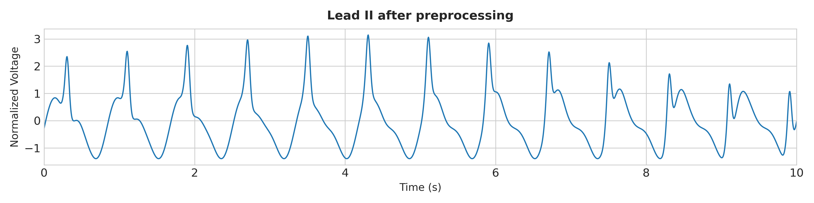
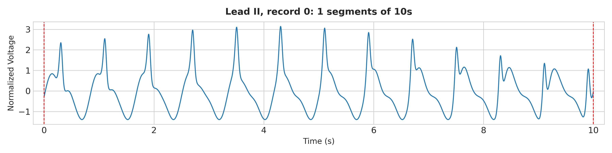
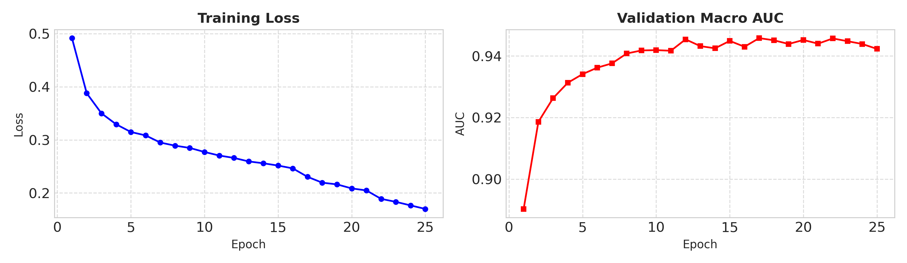

# 🫀 Multi-Label ECG Signal Classification using Hybrid CNN-RNN Architecture

PyTorch cha wapar karun PTB-XL dataset var 12-lead ECG signals cha multi-label classification karnara Deep Learning pipeline.

---

## 📌 Features (Mukhya Vaishishtye)

- **DSP Signal Preprocessing:** 0.5 – 40 Hz Butterworth Bandpass Filter, 200 Hz Resampling aani Z-score Normalization.
- **Multi-Scale Convolution:** Multi-kernel 1D CNNs ($k=5, 15, 25$) cha wapar karun dynamic local waveforms extract karnyasaathi.
- **Res-SE & Recurrent Blocks:** Squeeze-and-Excitation Residual blocks aani long-range sequence modeling sathi BiLSTM / BiGRU layers.
- **Multilabel Stratification:** Train, Validation aani Test split sathi `MultilabelStratifiedShuffleSplit`.

---

## 📊 Visual Outputs & Performance

### 1. Preprocessed ECG Signal & Segmentation
| Preprocessed Signal (Lead II) | 10-Second Window Segmentation |
| :---: | :---: |
|  |  |

### 2. Training Curves & Validation Macro AUC


---

## 📂 Repository Structure

```text
.
├── ecg_hybrid_cnn_rnn.py   # Main PyTorch training & evaluation script
├── lead_II_preprocessed.png# Preprocessed signal plot
├── lead_II_segmented.png   # Segmented window plot
├── training_metrics.png    # Loss & Macro AUC validation graphs
├── requirements.txt        # Python package dependencies
├── .gitignore              # Files excluded from Git tracking
└── README.md               # Project documentation
